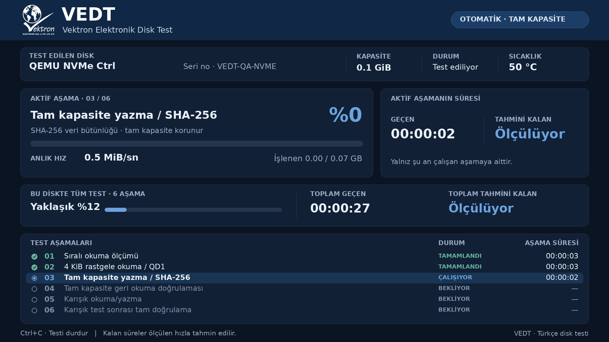

# VEDT — Vektron Elektronik Disk Test

Türkçe arayüz ve raporlarla HDD/SSD testi için geliştirilen açık kaynak teknik servis aracı. Önceki adı DiskTest86 idi; GitHub deposu VEDT olarak yeniden adlandırıldı; dahili `disktest` paket adı uyumluluk için korunuyor.

**Geliştirme sürümüdür. Ham disk testleri hedef diskin bütün verilerini siler.** Otomatik mod, açılış USB'si dışındaki uygun dahili diskleri sırayla seçer. Birleşik geliştirme imajı oluşturuldu; fiziksel donanım kabulü ve yeni Windows akışının tam kurulum kabulü henüz tamamlanmadı.

## 0.7 güncellemesi — 9 Kasım 2026

Koyu lacivert grafik panel, altı aşamanın tamamını gösteren durum listesi, aktif aşama ve bu diskteki tüm test için ayrı geçen/kalan süreler eklendi. Desteklenen ekranda 1080p tercih edilir; grafik ekran kullanılamazsa büyük yazılı metin görünümü korunur. [0.5/0.6 USB’yi 0.7’ye güncelleme](docs/GUNCELLEME-0.7.md).

169 Windows kaynak testi ve Linux'ta gerçek fio/ilerleme için 13 hedefli kontrol geçti. Gerçek donanımda ekran uyumluluğu ve hızlanma kabulü henüz yapılmadı. [0.7 doğrulama kapsamı](docs/validation-0.7/acceptance.json).



0.7 USB güncelleme paketinin SHA-256 değeri:

```text
0431f83e2d8d1eedb1d8d6a72b98e2e31196e2c7b7eb7a248b0f24dbd75d3361  VEDT-0.7-USB-GUNCELLEME.zip
```

## 0.6 güncellemesi — 9 Kasım 2026

Yarım kalan işlerde `R` + Enter, ardından `SIL` + Enter ile açık onay vererek baştan test başlatılabilir. Eski raporlar ve numaratör korunur. Tam kapasite yazma, SHA-256 ve iki tam okuma korunarak büyük bloklu sıralı I/O eklendi; son parça ayrıca doğrulanır. [Mevcut USB’yi güncelleme ve süre açıklaması](docs/GUNCELLEME-0.6.md).

## İndirmeler — tüm sürümler ve güncellemeler

**[VEDT sürüm ve güncelleme arşivini aç — Google Drive](https://drive.google.com/drive/folders/1jhm70ZRFvDzygHyTDAkBl_MCeJ69FVtC?usp=sharing)**

Birleşik USB imajları, önceki sürümler ve güncelleme paketleri bu klasörde paylaşılır. 0.7 grafik ekran paketi için yayımlandığında `VEDT-0.7-USB-GUNCELLEME.zip` dosyasını seçin; sürümünü kontrol edin. Yeni USB hazırlamak için istediğiniz sürümün `.img` dosyasını; mevcut 0.5 USB’yi raporları ve numaratörü koruyarak güncellemek için `VEDT-0.6-USB-GUNCELLEME.zip` paketini seçin. Dosyayı bilgisayara indirin; klasörün tamamını indirmeniz gerekmez.

0.6 dosyaları için beklenen SHA-256 değerleri:

```text
533e5bfd5da7cbbab4f80baa272953bb56f68aba49d15cc74b81bff6126107d9  VEDT-combined-0.6-dev.img
8ff7b291d9138124bd99201160631ce8fefe7c9e3156d06f90b98e51a941db79  VEDT-0.6-USB-GUNCELLEME.zip
```

Her sürümün kendi dosya adı ve SHA-256 kaydını esas alın; farklı sürümlerin özetleri birbirinin yerine kullanılamaz. [0.6 güncelleme adımları](docs/GUNCELLEME-0.6.md) · [USB hazırlama ve kullanım](docs/KULLANIM.md) · [0.6 doğrulama kaydı](docs/validation-0.6/acceptance.json).

**Geliştirme sürümüdür; uygun dahili disklerin bütün verileri silinir.** Windows ilk oturumu, fiziksel donanım ve Secure Boot kabul sınırları doğrulama kaydında belirtilir.

## Mevcut durum — 6 Kasım 2026

- SATA/NVMe kimlik denetimi ve açılış/rapor USB'sini koruma kontrolleri.
- Altı aşama: örnek sıralı okuma, rastgele okuma, tam kapasite yazma, tam kapasite doğrulama, karma erişim ve son tam kapasite doğrulama.
- SMART, desteklenen sensörlerden sıcaklık; boşta/yükte/aşama bazlı ortalama, en düşük ve en yüksek değerler.
- Renkli Türkçe konsol, genel özetin ardından teknik ayrıntılar içeren Türkçe PDF/HTML/JSON, SHA-256 manifesti ve verisi dahil hazır yapay zekâ yorumlama alıntısı.
- VEDT adı, Vektron logosu ve mavi-beyaz duvar kâğıdı/rapor tasarımı.
- USB'de saklanan numaratör: yeni disk testlerinde `VEDT1`, `VEDT2`, …; aynı rapor kimliğine aynı numara. Farklı USB'lerin sayaçları bağımsızdır; bu numara gerçek müşteri kaydı değildir.
- Oturum `VEDT54` ise rapor `VEDT54_SERI-NUMARASI.pdf`, masaüstü klasörü `VEDT54` olur.
- Windows hazırlık kodu: Türkçe Windows 11 Pro, numaralı yerel VEDT hesabı, masaüstüne rapor ve geçici kullanım uyarılı duvar kâğıdı.

**Birleşik akış Linux testlerini WinPE kurulumuna bağlar; üretim kabulü henüz verilmemiştir.** Ayrı QEMU laboratuvarında önceki `test` hesabıyla ilk oturum ve rapor kopyası doğrulandı. Yeni VEDT hesabı/numaratörü kod kontrollerinden geçti; yeni Windows ilk oturum kabulü yapılmadı. Windows laboratuvarında uygulama hizmeti çökme uyarıları da kaydedildi; sorun çözülmüş sayılmıyor.

Son Windows kaynak kontrolü: **151 başarılı, 3 Linux'a özgü test atlandı**. Yeni 0.5 birleşik imajında 64 MiB sanal SATA ve NVMe disklerinde altı aşama doğrulandı; Linux → WinPE geçişi ve geçersiz işin yazmadan reddedilmesi de kontrol edildi. Bunlar fiziksel disk veya son Linux → Windows zinciri kabulü yerine geçmez. ATTO dahil değildir.

## Güvenli dosya demosu

Python 3.11+ ile depo kökünde:

```sh
python -m venv .venv
# Linux: source .venv/bin/activate
# Windows PowerShell: .venv/Scripts/Activate.ps1
python -m pip install -e ".[test]"
python -m disktest demo --reports reports
python -m pytest -q
```

`demo` yeni geçici normal dosya üzerinde çalışır; fiziksel disk sağlığını ölçmez. Ham aygıt/otomatik mod silme yetkisi gerektirir. Üretim bilgisayarında deneme amacıyla otomatik modu başlatmayın.

## Belgeler

- [USB hazırlama ve adım adım kullanım](docs/KULLANIM.md)

- [Türkçe rapor okuma kılavuzu — şema 1](docs/RAPOR-REHBERI-V1.md)
- [Yapay zekâ ile rapor yorumlama](docs/YAPAY-ZEKA-ILE-YORUMLAMA.md)
- [Derleme ve geliştirme](docs/GELISTIRME.md)
- [Kalan işler ve doğrulama sınırları](docs/DURUM.md)

Yapay zekânın bağlantıları kendiliğinden açacağı garanti edilmez. İnternet erişimi olan araca kılavuzu incelemesini isteyin; `session.json` sürümü ve belge bağlantılarını taşır. Paylaşmadan önce seri numarası gibi bilgileri gözden geçirin.

## Açık kaynak

Proje kodu [MIT lisanslıdır](LICENSE). Vektron logosu ve markası bu lisansla lisanslanmaz; haklar hak sahibinde kalır. [Üçüncü taraf notları](THIRD-PARTY-NOTICES.md).

Windows ISO/WIM ve üçüncü taraf ikilileri Git deposuna dahil değildir. Birleşik geliştirme imajı için yukarıdaki harici Google Drive bağlantısı kullanılır. Windows lisansı/etkinleştirme sağlanmaz; Windows ve diğer bileşenlerin kendi lisans koşulları geçerlidir.
