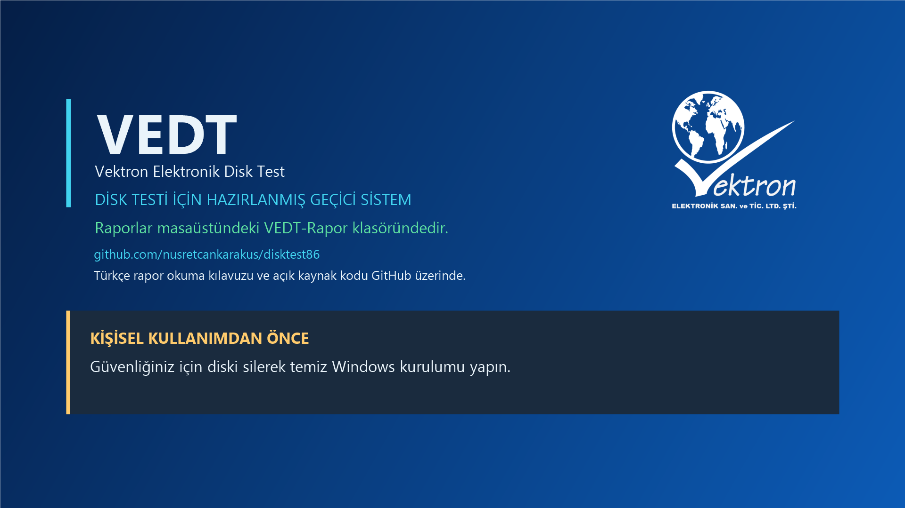

# VEDT — Vektron Elektronik Disk Test

Türkçe arayüz ve raporlarla HDD/SSD testi için geliştirilen açık kaynak teknik servis aracı. Önceki adı DiskTest86 idi; GitHub adresi ve dahili `disktest` paket adı uyumluluk için korunuyor.

**Geliştirme sürümüdür. Ham disk testleri hedef diskin bütün verilerini siler.** Otomatik mod, açılış USB'si dışındaki uygun dahili diskleri sırayla seçer. Fiziksel donanım kabulü ve son birleşik USB imajı henüz tamamlanmadı.



## Mevcut durum — 6 Kasım 2026

- SATA/NVMe kimlik denetimi ve açılış/rapor USB'sini koruma kontrolleri.
- Altı aşama: örnek sıralı okuma, rastgele okuma, tam kapasite yazma, tam kapasite doğrulama, karma erişim ve son tam kapasite doğrulama.
- SMART, desteklenen sensörlerden sıcaklık; boşta/yükte/aşama bazlı ortalama, en düşük ve en yüksek değerler.
- Renkli Türkçe konsol, genel özetin ardından teknik ayrıntılar içeren Türkçe PDF/HTML/JSON ve SHA-256 dosya manifesti.
- VEDT adı, Vektron logosu ve mavi-beyaz duvar kâğıdı/rapor tasarımı.
- USB'de saklanan numaratör: yeni disk testlerinde `VEDT1`, `VEDT2`, …; aynı rapor kimliğine aynı numara. Farklı USB'lerin sayaçları bağımsızdır; bu numara gerçek müşteri kaydı değildir.
- Windows hazırlık kodu: Türkçe Windows 11 Pro, numaralı yerel VEDT hesabı, masaüstüne rapor ve geçici kullanım uyarılı duvar kâğıdı.

**Windows hazırlığı tamamlanmış genel otomatik kurulum değildir.** Ayrı QEMU laboratuvarında önceki `test` hesabıyla ilk oturum ve rapor kopyası doğrulandı. Yeni VEDT hesabı/numaratörü kod kontrollerinden geçti; yeni Windows ilk oturum kabulü yapılmadı. Windows laboratuvarında uygulama hizmeti çökme uyarıları da kaydedildi; sorun çözülmüş sayılmıyor.

Son Windows kaynak kontrolü: **144 başarılı, 3 Linux'a özgü test atlandı**. Önceki 0.4 USB sürümünde 64 MiB sanal SATA/NVMe testleri doğrulandı. Bunlar fiziksel disk veya son Linux → Windows zinciri kabulü yerine geçmez. ATTO dahil değildir.

## Güvenli dosya demosu

Python 3.11+ ile depo kökünde:

```sh
python -m venv .venv
# Linux: source .venv/bin/activate
# Windows PowerShell: .venv/Scripts/Activate.ps1
python -m pip install -e ".[test]"
python -m disktest demo --reports reports
python -m pytest -q
```

`demo` yeni geçici normal dosya üzerinde çalışır; fiziksel disk sağlığını ölçmez. Ham aygıt/otomatik mod silme yetkisi gerektirir. Üretim bilgisayarında deneme amacıyla otomatik modu başlatmayın.

## Belgeler

- [Türkçe rapor okuma kılavuzu — şema 1](docs/RAPOR-REHBERI-V1.md)
- [Yapay zekâ ile rapor yorumlama](docs/YAPAY-ZEKA-ILE-YORUMLAMA.md)
- [Derleme ve geliştirme](docs/GELISTIRME.md)
- [Kalan işler ve doğrulama sınırları](docs/DURUM.md)

Yapay zekânın bağlantıları kendiliğinden açacağı garanti edilmez. İnternet erişimi olan araca kılavuzu incelemesini isteyin; `session.json` sürümü ve belge bağlantılarını taşır. Paylaşmadan önce seri numarası gibi bilgileri gözden geçirin.

## Açık kaynak

Proje kodu [MIT lisanslıdır](LICENSE). Vektron logosu ve markası bu lisansla lisanslanmaz; haklar hak sahibinde kalır. [Üçüncü taraf notları](THIRD-PARTY-NOTICES.md).

Windows ISO/WIM, Windows lisansı ve üçüncü taraf ikilileri depoya dahil değildir. Windows içeren nihai Rufus imajı henüz yayımlanmadı.
